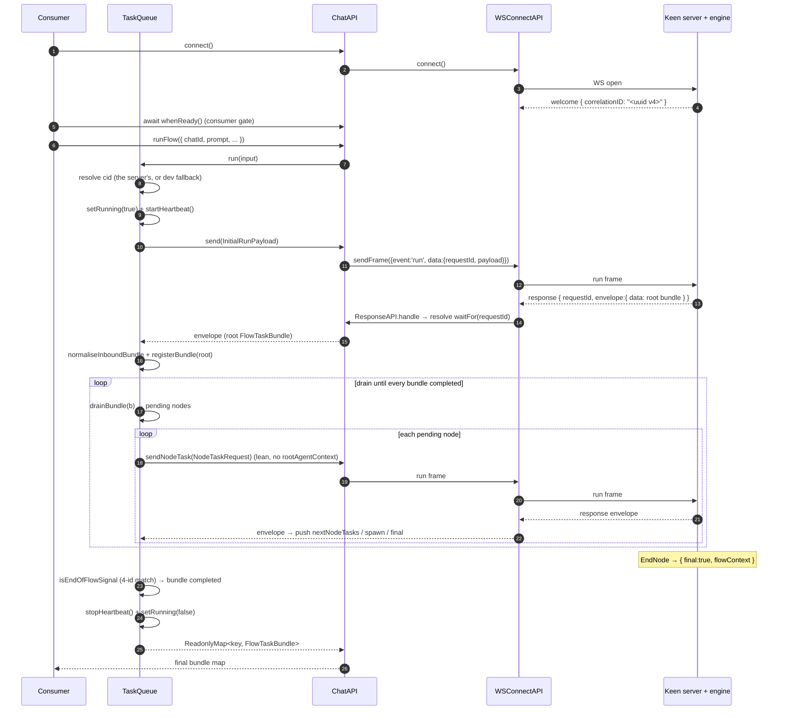
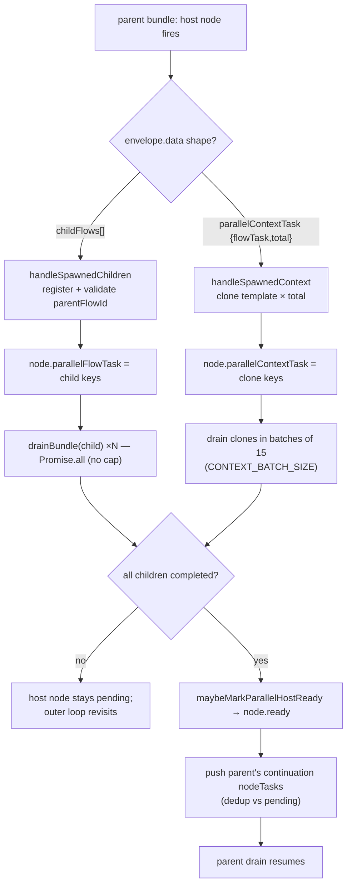

# TaskQueue — the client-side flow orchestration engine

> Deep reference for `sdk/task-queue.ts` and the frames it exchanges with the Keen server.
> Written for someone building their own client on `sdk/`, or debugging a live run.
> Every load-bearing claim cites `file:line` **verified against the `agent-runner/sdk/`
> code**. Where an existing doc or a comment disagrees with that code, this document
> trusts the code and says so in a **⚠️ Note**.

**Provenance.** `agent-runner/sdk/` is the Keen 15.3 ChatSDK (reconnect / resume, the prompt limit,
`onSummarizing`; `KeenChat` + `HOW_TO_USE` not included). The public reference site's `main` still
ships the earlier SDK without them. The `App.Chat.*` ambient types the
SDK references (every `chat.d.ts` anchor below) live in entanglement's `src/@types/chat.d.ts` —
agent-runner does not ship them, `tsx` runs the SDK untyped. The
canonical prose already exists and this document **consolidates** it rather than
reinventing it — read those as companions, but note the `file:line` anchors here are the
**agent-runner** copy (line numbers differ slightly from the Test WS React tree).

> **Not in this package.** The companion docs below, `HOW_TO_USE.md`, and the server-side
> anchors (`relay.gateway.ts` = the Keen relay's source) live in the maintainers' repos; they are
> cited for provenance only. `chat.d.ts` is in the reference partner site —
> `/keen-entanglement-download` puts it at `<site>/src/@types/chat.d.ts`. Everything this
> document claims is checkable against `agent-runner/sdk/` alone.

| Existing doc | Covers |
|---|---|
| `Test WS React/docs/DRIVE-LOOP.md` | the drive loop = TaskQueue orchestration (most relevant) |
| `Test WS React/docs/DECISIONS.md` | the non-obvious calls (the "dragons") — cited as **[D§N]** below |
| `Test WS React/docs/SDK-LAYERING.md`, `LIFECYCLE.md`, `MODULES.md`, `ARCHITECTURE.md` | where TaskQueue sits, why the client drives |
| `entanglement/src/service/services/chat/HOW_TO_USE.md` (not copied into `agent-runner/sdk/`) | consumer usage |

---

## Table of contents

1. [Role & mental model](#1-role--mental-model)
2. [The full lifecycle, in order](#2-the-full-lifecycle-in-order)
3. [The wire formats — every frame](#3-the-wire-formats--every-frame)
4. [The node-task drain loop](#4-the-node-task-drain-loop)
5. [Parallel fan-out](#5-parallel-fan-out)
6. [Tool dispatch & virtual nodes](#6-tool-dispatch--virtual-nodes)
7. [Identity & keys](#7-identity--keys)
8. [Retries & status codes](#8-retries--status-codes)
9. [Cancel & teardown](#9-cancel--teardown)
10. [Heartbeat](#10-heartbeat)
11. [What to expect on `onStream`](#11-what-to-expect-on-onstream)
12. [Consumer quick-start](#12-consumer-quick-start)
13. [Constants reference](#13-constants-reference)
14. [Divergences from the existing docs](#14-divergences-from-the-existing-docs)
15. [Reconnect and resume](#15-reconnect-and-resume)

---

## 1. Role & mental model

The Keen flow engine is a **pure per-node function**:

```
(cid, nodeId, payload) → { result, nextNodeTasks }
```

It executes exactly one node when asked, returns that node's result plus a hint about
which node(s) come next, and then **stops**. It does **not** chain to the next node on
its own, and it does **not** retry on its own. It holds per-`cid` state (dictionary,
session, agent-state, tree-context, cookie-storage) in the platform's fast store with a
~60 s TTL, but it never advances the flow without a fresh request.

**TaskQueue is the thing that drives it.** One `TaskQueue` per `ChatAPI` (`index.ts:102`);
a new chat session gets a new one. It owns *all* orchestration: sending the initial prompt
and every per-node continuation, the drain loop over returned `nextNodeTasks`, parallel
fan-out, retries (transport + response), cancel + local teardown, and the heartbeat.

The invariant: **the server is stateless-per-call about *what to do next*; the client is
the state machine.** Everything the engine returns is a *hint* the client chooses to act
on — including bundle-level `completed`/`ready` flags, which the client deliberately
overwrites to `false` on arrival (`scrubInboundNode`, `task-queue.ts:1456`; and in
`normaliseInboundBundle`, `:1810`) because those are *client-owned* execution state, not
server truth **[D§1]**.

**Its place in the stack** (see `SDK-LAYERING.md`):

```
ChatAPI (index.ts)  ──── the only public front door; consumers depend only on this
   ├── TaskQueue        ── orchestration (this document)
   ├── SendRequest      ── one outbound "run" frame + transport-retry loop
   ├── ResponseAPI      ── inbound frame routing (envelope vs stream) + waitFor
   └── WSConnectAPI     ── the raw WebSocket + the welcome/cid capture
```

TaskQueue never touches the socket directly. It calls back *up* into its owning `ChatAPI`
(`chat`, `task-queue.ts:93`) for `send`, `sendNodeTask`, `waitFor`, `sendCancel`,
`sendPing`, `getCorrelationID`, `setCorrelationID`, and the live `accessToken`.
`ChatAPI` is the only public surface; the sub-apis are `readonly` fields, never
barrel-exported **[D§9]**.

---

## 2. The full lifecycle, in order

Entry point: `TaskQueue.run(input)` (`task-queue.ts:107`), reached from `ChatAPI.runFlow`
(`index.ts:126`).

### Step 0 — re-entry guard

`run()` throws immediately if `this.bundles.size > 0` or a run is in flight
(`"TaskQueue already running"`). A cancelled or lost run settles at once while its node
loops unwind in the background; the next `run()` waits (≤ 2 s) for that unwind first. One flow tree at a time per TaskQueue — `await` each turn,
never run two concurrently on one `ChatAPI`.

### Step 1 — resolve the connection cid

```ts
let correlationId = this.chat.getCorrelationID();   // task-queue.ts:142
if (!correlationId) {
    correlationId = generateRequestId();            // dev-only fallback
    this.chat.setCorrelationID(correlationId);      // register on the connection
}
```

The **cid (correlationId) is connection-scoped**, assigned by the Keen server via a `welcome`
frame sent once right after the socket opens (`connect.ts:574`–`607`). If it has arrived,
`getCorrelationID()` returns it; if not, TaskQueue mints a client-side fallback and
registers it (`setCorrelationID`, `connect.ts:256`), which also resolves the
`welcomePromise`.

The fallback is a **deliberate dev affordance [D§7]**, not the primary path. In production
the Keen server always sends `welcome`, and the *consumer* is expected to gate its first
`runFlow` on `await chat.whenReady()` (see §12 and the HOW_TO_USE Step 4). `run()` itself
does **not** internally await `whenReady()` — it reads whatever cid is currently on the
connection and mints a fallback if none exists yet.

### Step 2 — arm running-state + heartbeat

```ts
this.setRunning(true);      // fires onRunning(true) — gates "is a flow in flight" UI
this.startHeartbeat();      // ping every HEARTBEAT_INTERVAL_MS (5s)
```

(`task-queue.ts:164`–`165`.) Both are torn down in the outer `finally`
(`task-queue.ts:214`–`221`) so they flip back on **every** exit path — success, throw, or
cancel. `setRunning` is idempotent (`:1745`). The heartbeat keeps the engine's dict/session
TTLs alive between per-node calls (§10).

### Step 3 — build + send the initial run payload

The `InitialRunPayload` is assembled at `task-queue.ts:226`–`256` (fields in §3.2). It
carries `userContext`, `rootAgentContext`, `chatContext`, a freshly-minted `flowContext`
(`sessionId` + `requestId` both `generateRequestId()`), and `requestContext.cookies` resolved
from `ChatAPIOptions.cookies` (`resolveRequestCookies`, `utils.ts:85`–`91`: an explicit
`{ name: value }` map is forwarded as-is — how a headless caller such as `run.ts --cookie`
supplies them — otherwise a name allow-list is read from `document.cookie`) **on the initial
run only** (`:253`–`255`).

```ts
const requestId = await this.chat.send(payload);     // :669  → frame requestId
const envelope  = await this.chat.waitFor(requestId);// :671  → matching reply
```

`chat.send` → `SendRequest.execute` with `maxRetries = INITIAL_MAX_RETRIES` (10) and
`opts.requestId` = the run frame's **visit id**, minted once in `sendRunFrame` and kept across
all its attempts (§15): it pushes the `run` frame, retries every 1 s until the
socket is READY (`isReady()`), returns that requestId.
`waitFor(requestId)` parks a promise in `ResponseAPI.pending` keyed by that frame requestId;
it resolves when a response frame with a matching `requestId` and an `envelope` arrives
(`response.ts:56`–`77`), or rejects on `RESPONSE_TIMEOUT_MS` (10 min, `response.ts:108`).

### Step 4 — validate + normalise the root bundle

```ts
if (this.cancelled) throw new Error('TaskQueue cancelled');   // :687
// the run frame goes through sendRunFrame: an E4 refusal is re-sent 10 × 1 s,
// any other non-success — or the 10th refusal — throws envelope.message ?? envelope.code
const root = this.normaliseInboundBundle(envelope.data);      // :262
```

`normaliseInboundBundle` (`task-queue.ts:1785`) tolerates deviations: it hoists a sibling
`options` under `flowTask`, forces `flowContext.completed = false`, scrubs every inbound
node's `ready`/`inProgress` to `false` (`scrubInboundNode`, `:1456`), and prepends a
client-only `virtualStartNode` for script-tool bundles (§6).

Degenerate case: no `nodeTasks` → mark completed, register, return the snapshot
(`:269`–`276`). Otherwise capture `rootCorrelationId` (`:278`) and register the root (`:279`).

### Step 5 — the outer drain loop

```ts
while (!this.cancelled && this.hasIncomplete()) {                 // :287
    const incompletes = Array.from(this.bundles.values())
        .filter((b) => !b.flowTask.flowContext.completed);
    await Promise.all(incompletes.map((b) => this.drainBundle(b)));// :296
}
```

Each pass drains every not-yet-completed bundle **in parallel**. Bundles registered during
a pass (parallel children, context clones) are picked up on the next pass. `drainBundle`
(§4) walks one bundle's pending nodes until none remain, then flips `completed = true`
**only if** its parallel dependencies are all ready (`allParallelDependenciesReady`, `:1616`).

### Step 6 — settle

```ts
if (this.cancelled) throw new Error('TaskQueue cancelled');   // :304
return this.snapshotAndClear();                                // :307
```

`snapshotAndClear` (`:1727`) copies the final map, then `clear()`s (empties the map and
`emitUpdate()`s an empty snapshot). `run()` resolves with a frozen
`ReadonlyMap<string, FlowTaskBundle>`.

### The failure boundary

The body sits inside one `try/catch` (`task-queue.ts:183`–`221`). **Any** throw funnels
through one catch that (a) fires `chat.sendCancel()` so the engine wipes every stored
entry under the cid, unless the user already cancelled or the connection was lost, and (b) `clear()`s local state, then
re-throws. Cancel is a **blunt instrument** — one spurious terminal error takes down the
whole tree **[D§8]**, which is why the terminal-code classification is kept tight (§8).

### Sequence diagram



---

## 3. The wire formats — every frame

### 3.1 The six sibling context blocks

The wire model is **flat**: there is no `root` wrapper. Identity is grouped into named
sibling blocks. A full `FlowTask` (`chat.d.ts:491`) carries all six; individual payloads
carry a subset.

| Block | Fields | Scope | Sent by client on… |
|---|---|---|---|
| `userContext` | `userId`, `email`, `accessToken?` | tree-invariant identity | initial + every per-node (accessToken **re-stamped every frame**) |
| `rootFlowContext` | `flowId`, `correlationId`, `sessionId`, `requestId` | tree root identity (engine-set once) | every per-node (**not** on the initial payload) |
| `rootAgentContext` | `agentId`, `prompt` | the agent + user prompt | initial only (**dropped** from the lean NodeTaskRequest) |
| `chatContext` | `chatId`, `projectId` | conversation + project | initial + every per-node + every clone |
| `flowContext` | see 3.5 | **per-call** flow identity | every frame (shape varies root vs child) |
| `options` | `Record<string, unknown>` | bundle-level tool/side-band pack | inside the bundle; seeded onto node sends for tool flows |

**Tree-invariant** (identical start → end): `userContext`, `rootFlowContext`,
`rootAgentContext`, `chatContext`. **Per-flowTask** (differs per bundle/call): `flowContext`,
`options`.

`accessToken` is the one field not echoed untouched. The Keen server verifies it **per message**
(`verifyWithChain` + `token.sub === userId`), and the server-echoed `userContext` on
continuations/children **drops** it — so TaskQueue re-stamps `this.chat.accessToken` onto
every outbound frame's `userContext` (`task-queue.ts:773`, `:1648`). This is the intended,
documented behavior (HOW_TO_USE Step 1); see §14 for the stale comments that claim otherwise.

### 3.2 `InitialRunPayload` — SENT on the first frame

Built at `task-queue.ts:226`–`256`, wrapped as `{ event:'run', data:{ requestId, payload } }`.

| Field | Type | Meaning |
|---|---|---|
| `userContext.userId` | string | `input.userId ?? chat.userId` (**must equal the token's `sub`**) |
| `userContext.email` | string | `input.email ?? chat.email` |
| `userContext.accessToken` | string | `chat.accessToken` (live value) |
| `rootAgentContext.agentId` | string | `input.agentId ?? chat.agentID` — the agent slug |
| `rootAgentContext.prompt` | string | the user's prompt text |
| `chatContext.chatId` | string | `input.chatId` (REQUIRED — the chat_history key) |
| `chatContext.projectId` | string | `input.projectId ?? chat.projectID` (== space id) |
| `flowContext.correlationId` | string | the connection cid from step 1 |
| `flowContext.sessionId` | string | freshly minted `r-<uuid>` |
| `flowContext.requestId` | string | freshly minted `r-<uuid>` (flow-tree requestId, **not** the frame requestId) |
| `requestContext.cookies` | `Record<string,string>` | from `ChatAPIOptions.cookies` — an explicit map used as-is (headless) or an allow-list of names read from `document.cookie` (HttpOnly never visible); initial run only → the engine stores them for the run |

The initial payload carries **no `rootFlowContext`** — the engine sets it once in
`runInitialPayload` and echoes it in the bundle. `chat.d.ts:177` declares
`flowContext.correlationId` optional, but TaskQueue always populates it.

### 3.3 `NodeTaskRequest` — SENT per node (LEAN)

Built at `task-queue.ts:766`–`809`, sent via `chat.sendNodeTask` (`index.ts:311`).
**Lean by design** — it drops `rootAgentContext`. The engine resolves the prompt via
`agentStateMgr.getRootAgentPrompt(cid, agentId)` and agentId via the run's tree-context
written at init (`chat.d.ts:307`).

| Field | Type | Meaning |
|---|---|---|
| `userContext` | UserContext | `{ ...flow.userContext, accessToken: chat.accessToken }` — token re-stamped |
| `rootFlowContext` | RootFlowContext | the tree root's `{flowId, correlationId, sessionId, requestId}`, verbatim |
| `chatContext` | ChatContext | `{chatId, projectId}`, verbatim |
| `flowContext` | FlowContext | the per-call context (see 3.5) |
| `nodeContext.id` | string | which node to run |
| `nodeContext.kind` | string | node kind (agentNode, scriptNode, endNode, …) |
| `nodeContext.initial?` | boolean | present only if set; forwarded to the engine (lazy dict/session creation). It no longer bounds retries — only the run frame is bounded (§8) |
| `options?` | `Record<string,unknown>` | tool side-band (see §6) |

### 3.4 `ContextRunPayload` — a DEFINED shape the current TaskQueue does NOT send

`ContextRunPayload` (`chat.d.ts:354`) and `ChatAPI.sendContextRun` (`index.ts:332`) are
fully defined, but **TaskQueue never emits either.** For a `parallelContext` fan-out it
clones the template bundle locally and drains each clone through the ordinary per-node
`NodeTaskRequest` path (the in-code comment says so, `task-queue.ts:1520`–`1532`). This is
**deliberately dormant** — the seed of a future large-N wire optimization; do not delete it
in a cleanup pass **[D§3]**.

### 3.5 `FlowContext` on the wire (per-call)

Assembled as `outgoingFlowContext` (`task-queue.ts:722`–`764`). Only present fields are
spread onto the wire:

| Field | Always? | Meaning |
|---|---|---|
| `correlationId` | yes | this bundle's cid |
| `sessionId` | yes | this bundle's session |
| `requestId` | yes | this bundle's flow-tree requestId |
| `flowId` | **only if non-root** | root omits it — engine reads it from `rootFlowContext.flowId`. `isRoot = rootFlowContext.flowId === fc.flowId && !parentFlowId && contextNumber === undefined` (`:718`) |
| `currentFlowId` | if present | the dict-owning flow; a runFlow/jumpFlow child inherits its spawner's so it stays on the calling flow's dict |
| `parentFlowId` | if present | immediate spawner's flowId |
| `parentSessionId` | if present | "use the parent's session key" — set only on parallel siblings (§5.1). Engine resolves the session key as `parentSessionID ?? sessionID` **[D§5]** |
| `contextNumber` + `contextPath` | if `contextNumber` is a number | parallelContext clone coordinates; forwarded every call so the engine's dict seam fires for the clone's whole life |
| `correlationToken` | if present | per-call auth seal; absent until auth.utils mints it on the initial run |

### 3.6 `OutboundFrame` — the three frames TaskQueue causes

`chat.d.ts:384`–`408`:

| `event` | `data` | Meaning |
|---|---|---|
| `run` | `{ requestId, payload }` | initial run or per-node continuation. `requestId` is the **frame** id (`send-request.ts:104`) |
| `cancel` | `{ correlationId }` | tear down dict/session/agent-state/queue for the cid (`index.ts:420`) |
| `ping` | `{ protocol: 2 }` | heartbeat; the Keen server derives the cid from the socket (`index.ts:449`) |

### 3.7 Inbound response envelope

`ResponseAPI.handle` (`response.ts:56`) splits inbound frames by **envelope presence**:
`frame.data.envelope` present → resolve the matching `waitFor` and fire `onResponse`;
absent → fire `onStream` (§11). The `Envelope` (`chat.d.ts:13`):

| Field | Type | Meaning |
|---|---|---|
| `success` | boolean | true → act on `data`; false → error path |
| `code` | string | status code `E1xxx…E8xxx` (§8) |
| `message?` | string | human message |
| `data?` | unknown | the per-node result; TaskQueue discriminates its shape (below) |

**`envelope.data` shapes**, discriminated in `runRegularNode` after `envelope.success`
(`task-queue.ts:932`–`1037`), in this priority order:

| Shape | Detector | Handler |
|---|---|---|
| `{ final:true, flowContext:{flowId,correlationId,sessionId,requestId} }` | `isEndOfFlowSignal` (`:1365`) | mark bundle completed |
| `{ childFlows:[{flowTask,nodeTasks}, …], nodeTasks?:[…] }` | `isSpawnedChildrenResponse` (`:1136`) | `handleSpawnedChildren` (§5.1) |
| `{ parallelContextTask:{flowTask,total}, nodeTasks?:[…] }` | `isSpawnedContextResponse` (`:1261`) | `handleSpawnedContext` (§5.2) |
| `{ nextNodeTasks:[…] }` / `{ nodeTasks:[…] }` / single NodeTask / FlowTaskBundle echo | `extractIncomingNodes` (`:1398`) | push fresh nodes onto the bundle |

### 3.8 The spawn shape — `childFlows`

`{ childFlows: [ { flowTask, nodeTasks }, … ], nodeTasks?: [ …parent continuation… ] }`.
Each `childFlows[i].flowTask.flowContext.parentFlowId` **must** equal the spawning bundle's
`flowContext.flowId` (validated per-entry, `:1199`; a mismatch throws). The parent's
continuation `nodeTasks` are pushed **only after** all children drain (§5.1).

### 3.9 The endNode terminator

```
{ final: true, flowContext: { flowId, correlationId, sessionId, requestId } }
```

`isEndOfFlowSignal` (`task-queue.ts:1365`) requires `final === true` **and all four ids** to
match *this bundle's* `flowContext` (`:1384`–`1389`). The 4-id match is an integrity check: a
`final:true` with mismatched ids is a misroute and is **not** acted on (the bundle then
never naturally completes, but at least the wrong bundle isn't marked done). On a match:
`completed = true`, `node.ready = true`; a `virtualScriptNode` also appends a client-only
`virtualEndNode` (§6).

> **⚠️ Note:** `DRIVE-LOOP.md §4` says "the three ids must match"; the agent-runner code
> matches **four** (adds `flowId`). Code is authoritative.

---

## 4. The node-task drain loop

A `NodeTask` (`chat.d.ts:570`) is the wire shape `{ flowContext, nodeContext, options? }`
plus **client-owned** execution state the server never sees: `inProgress`, `ready`,
`response?`, and the normalised parallel-host references.

### 4.1 Three-state model

| State | Meaning | Set where |
|---|---|---|
| pending | `!inProgress && !ready` — needs firing | initial state after `scrubInboundNode` (`:1456`) |
| in-progress | a send is in flight | `processNode` sets `inProgress=true` (`:538`) |
| ready | node is done (result received / children settled) | `runRegularNode` (`:1034`), `maybeMarkParallelHostReady` (`:1565`) |

`scrubInboundNode` forces `ready`/`inProgress` to `false` on **every** inbound node — the
engine's optimistic `ready:true` is not trusted, otherwise the drain filter finds nothing
pending and the bundle "completes" without executing anything (`task-queue.ts:1442`–`1455`)
**[D§1]**.

### 4.2 `drainBundle` (`task-queue.ts:492`)

```
while not cancelled:
    pending = nodeTasks.filter(n => !n.inProgress && !n.ready)   // :498
    if pending is empty: break
    await Promise.all(pending.map(processNode))                  // :504
if allParallelDependenciesReady(bundle):
    bundle.flowContext.completed = true                          // :519
```

Every pending node fires **in parallel** each iteration; the loop repeats because a node's
response can push *new* pending nodes onto `nodeTasks`. The bundle is marked completed
**only if** every parallel-host node's referenced children are all completed
(`allParallelDependenciesReady`, `:1616`).

### 4.3 `processNode` (`task-queue.ts:533`) — the dispatch switch

```
if cancelled || ready || inProgress: return
inProgress = true
try:
    if node.parallelFlowTask is inbound bundle-array   → normaliseParallelFlowTask
    else if node.parallelContextTask is inbound object → normaliseParallelContextTask
    else if node is already a normalised parallel host → maybeMarkParallelHostReady
    else                                               → runRegularNode
finally:
    if not ready: inProgress = false
```

### 4.4 `runRegularNode` — the per-node send + push-back

1. Build `outgoingFlowContext` (§3.5) and the lean `NodeTaskRequest` (§3.3).
2. Response-retry loop (§8): `sendNodeTask` → `waitFor`, stamp `node.response = envelope`
   (`:930`, for the inspector).
3. On `success`, discriminate `envelope.data` (§3.7): end signal → complete; spawn/context
   → hand off (§5); otherwise `extractIncomingNodes(data)` → **dedup against pending ids
   only** → `bundle.nodeTasks.push(...fresh)` → `node.ready = true`.

**Why dedup only against *pending* entries** (`:1024`–`1029`) **[D§2]**: a server that
re-echoes a currently-queued node (infinite-loop guard) is filtered out, while a
`jumpFlowNode` legitimately re-returning a node whose id already *ran* gets pushed as a
**fresh** entry — so a loop's nodeTasks array grows by one per iteration.

`extractIncomingNodes` (`:1398`) accepts four "next nodes" carriers: `{ nextNodeTasks:[…] }`,
`{ nodeTasks:[…] }`, a bare single NodeTask (`looksLikeSingleNodeTask`, `:1428`), or a full
`FlowTaskBundle` echo. It is now a **pure pass-through** that only re-scrubs flags — the old
ToolNode envelope translation was removed.

> **⚠️ Note:** `NodeTask.nextNodes?: string[]` (`chat.d.ts:632`) is declared but **never
> read** by TaskQueue — next-node info flows via `envelope.data`.

---

## 5. Parallel fan-out

Three spawn shapes, all normalised to **bundle-id arrays** so the tree stays flat. The host
node only goes `ready` when *every* referenced child bundle is `completed`
(`maybeMarkParallelHostReady`, `:1554`). Two entry paths per kind: **envelope-carried** (the
primary path — the spec ships the fan-out in `envelope.data`) and **node-carried** (a node
that arrives already holding the inbound object form).

| Node type | Wire shape | Session | Dict | Drain strategy |
|---|---|---|---|---|
| `runFlowNode` | `{ childFlows:[{flowTask,nodeTasks}], nodeTasks:[parent continuation] }` | child has own | tree dict (`root.flowId`) | `Promise.all` all children |
| `parallelInNode` | `parallelFlowTask: FlowTaskBundle[]` | **shared** via `parentSessionID ?? sessionID` **[D§5]** | tree dict | `Promise.all` all siblings |
| `parallelContext` | `parallelContextTask: { flowTask: template, total }` | **independent** per clone | **own** dict per clone (seed→merge→delete, engine-side) | **batched** (15 at a time), envelope path only |

### 5.1 Spawned children (`runFlowNode`) — `handleSpawnedChildren` (`:1188`)

1. Normalise + validate each child (`parentFlowId` must match the bundle, `:1199`),
   `registerBundle` each.
2. Attach child keys to `node.parallelFlowTask` as `string[]` (`:1210`).
3. `await Promise.all(childBundles.map(drainBundle))` — settles on the **slowest** child
   (`:1219`).
4. `maybeMarkParallelHostReady(node)` (`:1225`).
5. **Only then** push the parent's continuation `nodeTasks` (deduped against pending)
   (`:1241`–`1253`).

Load-bearing ordering: **register → attach keys → drain all → mark host ready → THEN push
the parent's continuation.** Pushing earlier would let the parent's next nodes race their
own children. Node-carried variant: `normaliseParallelFlowTask` (`:1471`).

### 5.2 parallelContext — `handleSpawnedContext` (`:1285`)

The engine sends **one template bundle + `total`** — O(1) on the wire regardless of N.

1. `cloneBundleForContext(bundle, template, index)` × `total` (`:1299`). Each clone gets a
   **fresh** `flowId`, `sessionId`, `requestId` (all `generateRequestId()`),
   `parentFlowId = parent.flowId`, `flowContext.contextNumber = index`, inheriting the
   parent's `rootFlowContext` / `rootAgentContext` / `chatContext` unchanged (`:1657`).
   `chatContext` stays identical across all clones so every history row groups under the
   originating chat.
2. Register each; attach the id array to `node.parallelContextTask` (`:1305`).
3. Drain in **sequential batches of `chat.contextBatchSize ?? CONTEXT_BATCH_SIZE`** (default 15;
   per instance via `ChatAPIOptions.contextBatchSize`, `index.ts:92`–`95`) — fire a batch, wait
   for all of it, next batch (`:1316`–`1333`). 15 < the engine's ~33 admission slots so a single fan-out won't
   self-reject; a 10 k-context collection never floods the engine. Logs
   `[parallelContext] N/total contexts ready` per batch.
4. `maybeMarkParallelHostReady` (`:1339`), then push the parent's continuation (`:1341`–`1353`).

> `contextNumber` lives on `flowContext` (`:1666`), not on `options`. Some comments/docs
> loosely say "options.contextNumber / options.context" — the authoritative location is
> `flowContext.contextNumber`.

> **⚠️ Note — batching is inconsistent across paths.** Only `handleSpawnedContext`
> (envelope-carried parallelContext) batches at 15. The node-carried
> `normaliseParallelContextTask` (`:1506`) and **both** `parallelFlowTask` paths
> (`:1219`, `:1486`) fire *all* children at once via `Promise.all` with no cap. A large
> fan-out arriving as `childFlows` or node-carried is not throttled the way the primary
> context path is. (`DECISIONS.md §3` notes a stale in-code comment saying "batches of 10";
> the real `BATCH` constant is **15**, `settings.ts:72`.)

### Fan-out diagram



### 5.3 Lazy allocation

The client only *registers* bundles and drains — it never pre-creates engine state. The
engine write-opens dict/session at the **first** node that does work (the start node), not
at spawn **[D§6]**. So a `dict not found` on a **non**-start node means the dict was
*deleted* (cancel / clone-merge / TTL), never "not yet written". Don't add a "warm the dict"
call.

---

## 6. Tool dispatch & virtual nodes

the engine fans out a `<SYSTEM CALL>` to a tool as a **spawned childFlow** (the
`isSpawnedChildrenResponse` path, §5.1) with `flowTask.toolFlow = true`. Two flavors ride
the same shape:

| Tool flavor | childFlow shape | Routed to | flow engine auto-propagates `options`? | Client injects virtual chain? |
|---|---|---|---|---|
| **flow tool** | a normal flow bundle (start → middle → end) | the flow engine | **yes** (caches `flowTask.options`, injects into each inner node) | no — real nodes already chain |
| **script tool** | ONE node, `kind === 'virtualScriptNode'` | **the script engine directly** (bypasses the flow engine) | **no** | **yes** (§ below) |

### 6.1 The `options` injection rule **[D§11]**

In the `NodeTaskRequest` builder (`task-queue.ts:799`–`808`), `options` is set by two rules
in priority order: (1) explicit `node.options` wins; (2) otherwise, for **any** nodeTask in a
`toolFlow:true` bundle, seed from `flow.options` — **regardless of `initial`**. The old
`initial === true` gate fit flow tools but broke script tools: a script-tool childFlow's only
node is `initial:false` and routes direct to the script engine, so the client SDK is the only
place that can carry the `toolContext` onto the wire. Don't bring back the `initial` gate.

### 6.2 The virtual chain (client-only, zero-wire) **[D§12]**

For a script-tool childFlow, the visualizer would otherwise show a lone card. The client
restores symmetry with two synthetic, `ready:true` nodes that **never travel on the wire**:

- **`virtualStartNode`** prepended in `normaliseInboundBundle` (`task-queue.ts:1825`–`1840`)
  when `flowTask.toolFlow === true && nodeTasks[0].nodeContext.kind === 'virtualScriptNode'`.
  Id `vStart-<uuid>`, `initial:false`, `flowContext` copied from the virtualScriptNode, a
  synthetic `{ success:true, code:'E1001', message:'OK' }` response.
- **`virtualEndNode`** appended in `runRegularNode` (`:959`–`967`) when the `{ final:true }`
  terminator fires **and** the firing node's `kind === 'virtualScriptNode'`. Id `vEnd-<uuid>`.

> The legacy `NodeTask.pendingAgentRedispatch` sidecar is **gone** — confirmed absent from the
> agent-runner `chat.d.ts`. Both tool flavors use the unified `childFlow + parent's
> continuation` pattern; the agentNode-redispatch arrives on the same envelope
> (`{ childFlows:[…], nodeTasks:[agentNode redispatch] }`) with
> `options: { toolResponse:true, promptMarker }` so the engine sources the new prompt from
> the tool's response. Do not reintroduce the sidecar.

---

## 7. Identity & keys

### 7.1 The bundle key

Every bundle is stored under `bundleKey(flowContext)` =
`` `${correlationId}_${sessionId}_${flowId}` `` (`task-queue.ts:30`). All three ids together,
so one flow tree holds root + parallel siblings + context clones without `flowId` collisions.

### 7.2 The id families

| Id | Origin | Shape | Role |
|---|---|---|---|
| **cid / correlationId** | the Keen server's `welcome` (`connect.ts:628`), or dev fallback (`task-queue.ts:145`) | a bare UUID v4 minted by the relay (`relay.gateway.ts:117`) / `r-<uuid>` (fallback) | connection-scoped; the whole tree shares it; cancel key |
| **flowContext.sessionId** | `generateRequestId()` at init / per clone | `r-<uuid>` | session-storage scope; siblings share the parent's via `parentSessionId` **[D§5]** |
| **flowContext.flowId** | engine (root), `generateRequestId()` (clones) | `r-<uuid>` | dict scope + bundle-key component |
| **flowContext.requestId** | `generateRequestId()` at init / per clone | `r-<uuid>` | the **flow-tree** requestId; part of `rootFlowContext` + the endNode 4-id integrity check |
| **frame requestId = the node-visit id** | `runRegularNode` / `sendRunFrame`, once per node visit (`opts.requestId`; `SendRequest.execute` mints one only when none is given) | `r-<uuid>` | `waitFor` match key; the re-send registry key; the relay's reply-buffer / lease key and the engine's ProcessCoordinator dedup key |

> **⚠️ Two distinct requestIds.** The `requestId` inside `payload.flowContext` (flow
> identity) is **not** the `data.requestId` on the frame envelope (waitFor / dedup). Both are
> `r-<uuid>`. `ResponseAPI` keys on the **frame** one. Since Keen 15.3 it is the
> **stable node-visit id**: minted ONCE per node visit and carried by every transport retry,
> every response retry (E4 / E7 / a timeout / the E3002 refresh) and every re-send after a
> resume. That lets the relay recognise a re-send of the same node (answer from its reply
> buffer, or join the dispatch in flight) and is the prerequisite for the planned
> engine-side `exec:{cid}:{requestId}` ("a node runs at most once").

### 7.3 Why global uniqueness — the headline fix **[D§4]**

`generateRequestId()` = `` `r-${generateUUID()}` `` (`utils.ts:44`). The engine's
`ProcessCoordinator` dedups in-flight work by **requestId alone, process-global** — not
per-cid (`utils.ts:30`–`42`). The old per-tab `r-<base36 time>-<seq>` counter minted
identical ids across tabs running in lockstep; the engine rejected the collision as a
spurious **E2003 "Duplicate requestId"** (non-retryable), so the TaskQueue catch fired
`sendCancel()` → `deleteByCid` wiped every dict for the cid → sibling clones cascaded into
**E6002 "flow cancelled or stale"**. A 10-tab load test failed ~3/10 this way; the fix made
all client ids globally unique through this one chokepoint (10/10 clean after). The **hard
law: any id the engine treats as globally unique must be globally unique on the client** —
never reintroduce a counter.

> **⚠️ Note — the *mechanism* differs from `DECISIONS.md §4`.** That doc (and DRIVE-LOOP §5)
> say `generateRequestId()` returns `` `r-${crypto.randomUUID()}` ``. The **agent-runner
> code does NOT use `crypto.randomUUID`** — it hand-rolls an RFC-4122 v4 from
> `crypto.getRandomValues` (`utils.ts:17`–`28`), *deliberately*, because `randomUUID` is
> secure-context-only and is `undefined` on a plain-http dev origin (`utils.ts:7`–`9`). The
> entanglement `HOW_TO_USE.md` agrees with the code (`generateUUID()`, not `randomUUID`).
> The *outcome* (globally-unique v4) and the reasoning in §4 are correct; only the named API
> is stale. Code is authoritative.

### 7.4 Integrity checks (client-side)

The endNode **4-id match** (`isEndOfFlowSignal`, `:1365`) and the spawned-children
**`parentFlowId` match** (`:1199`). The Keen server's *per-frame* cid anti-spoof (rejecting a `run`
whose cid doesn't match the socket) is **server-side** and not in these SDK files.

> **Visualizer selection key is `(nodeId, requestId)`, not nodeId alone [D§13]** — the same
> `nodeId` legitimately recurs (agentNode redispatch after a tool; a loop body re-entering).
> Each invocation is a fresh NodeTask with its own `flowContext.requestId`, so the harness
> keys selection on the composite. (Harness concern, but it explains why `nodeTasks` holds
> repeated ids.)

---

## 8. Retries & status codes

### 8.1 Two layers of retry **[D§10]**

| Layer | Where | Fires on | Policy |
|---|---|---|---|
| **Transport** | `SendRequest.execute` (`send-request.ts:103`) | socket not READY (closed, or open but not resumed yet — frame couldn't be queued) | linear 1 s; `maxRetries` 10 for the run frame, `Infinity` for every node; returns `{ ok:false }` on exhaustion (`ChatAPI.send`/`sendNodeTask` turn that into a throw, `index.ts:294`–`296`, `:318`–`320`). Its ONE throw of its own: a frame over `MAX_FRAME_BYTES` (8 MiB, `settings.ts:93`) throws `FatalSendError` up front (`send-request.ts:122`–`128`) — non-retryable, re-thrown by the response loop (`task-queue.ts:905`–`907`) so the run aborts instead of retrying forever |
| **Run frame** | `sendRunFrame` (`task-queue.ts`) | an E4xxx reply to the run frame (the first prompt; the relay answers `E4001` for no-responders too) | re-send the frame (same visit id) after a fixed 1 s, `INITIAL_MAX_RETRIES` (10) attempts in all; the 10th refusal — or any other non-success — throws the envelope's message, so `runFlow` settles with a clean, terminal "busy" |
| **Response** | `runRegularNode` loop | transient non-success envelope, OR `send`/`waitFor` threw (timeout, drop) | re-issue the whole send+wait after `retryDelayMs`, `Infinity` attempts for EVERY node — the root flow's startNode and every `initial: true` node (child flows, parallelIn, clones, jumps) included: exponential backoff with **full jitter**, the pause after the n-th failure in a row random in [0, min(10 s, 1 s × 2^(n−1))] (caps 1 → 2 → 4 → 8 → 10 s), or an E4 refusal's `retryAfterMs` hint capped at 10 s |

`send` + `waitFor` share one try (`:870`–`918`) so a `waitFor` timeout on a continuation
feeds the *response* retry loop instead of escaping and killing an otherwise-recoverable flow
(`:861`–`868`). **Only the run frame is bounded** (Keen 15.3: the 10 × 1 s is
for the first prompt, while the flow has not begun): once the run frame is accepted the flow is
in and must finish, so every node — `initial: true` ones included, they all belong to a started
flow — retries forever; only the user's cancel ends it. `E2*` / `E3*` / `E8*` stay terminal
— except `E3002` with `ChatAPIOptions.onAuthExpired`: refresh ONCE, then retry the SAME visit
id; a second `E3002`, or a null refresh, is terminal (`Invalid token`); a refresh that throws
is retried after the backoff (§6.3). `E3101` stays terminal. A
`ConnectionLostError` (§15) is fatal like `FatalSendError`. Don't merge the loops.

**The continuation backoff (Keen 15.3).** Before, every continuation retried on a fixed 1 s with no jitter: in the `flood` load test (250 sockets) all of them hit the relay in lockstep. Now `retryBackoffMs` (`utils.ts`) gives the n-th failure in a row a random pause in [0, min(`RETRY_MAX_DELAY_MS`, `RETRY_BASE_DELAY_MS` × 2^(n−1))] — 1 → 2 → 4 → 8 → 10 s caps, never more than 10 s. The count is per node, so it resets when the node succeeds. If an E4xxx envelope carries `retryAfterMs` (top level or under `details`; `retryAfterHintMs`), that pause is used instead, capped at 10 s — the relay sends none today. The run frame keeps 10 × 1 s, so a refused first prompt settles in well under a minute; no node is bounded. The transport loop (`SendRequest`, socket not ready) keeps its linear 1 s. The relay retries refusals itself first (no-responders included, full jitter capped at 10 s; the run frame gets ~3 s), so a node's SDK retry follows a relay budget of minutes. Spec: `test/retry-backoff.test.ts` (`npm test`).

### 8.2 The status-code contract

The client classifies by **E-prefix**. `isTerminalErrorCode` (`task-queue.ts:1116`):
**`E2*`, `E3*`, `E8*` are terminal (throw); everything else is retried.**

| Prefix | Group | Client treatment | Example (source) |
|---|---|---|---|
| `E1xxx` | success | `envelope.success === true` path | `E1001` "OK" (`task-queue.ts:1832`) |
| `E2xxx` | client error (bad payload) | **terminal** — throw | `E2003` "Duplicate requestId" (`utils.ts:37`); `E2001` missing context (engine) |
| `E3xxx` | auth failure | **terminal** — throw | `E3002` "Invalid token" (`index.ts:135`); `E3101` space not allowed (`chat.d.ts:82`) |
| `E4xxx` | capacity / admission | **retried** | `E4001` admission reject (engine's ~33-slot gate; `settings.ts:70`) |
| `E5xxx` | resource | **retried** | `E5001` not-found (engine) |
| `E6xxx` | system | **retried** | `E6002` "flow cancelled or stale" (`utils.ts:38`); `E6101` |
| `E7xxx` | upstream | **retried** | upstream failures |
| `E8xxx` | explicit cancellation | **terminal** — throw | intentional termination |

A non-retryable code throws `envelope.message ?? envelope.code` (`:1079`–`1081`), hits the
failure boundary, fires `sendCancel`, propagates out of `run()`. The classic cascade: **E2003
→** run throws → `sendCancel(cid)` → engine wipes the cid → sibling clones report **E6002**.

> **The client's classification is deliberately broader than the wire's `E4*`-only
> retryability** (`DRIVE-LOOP §6`): the Keen `Status.isRetryable` convention is `E4*` only,
> but the client retries E4/E5/E6/E7 and treats only E2/E3/E8 as terminal — because a
> continuation's flow is already alive server-side, so it keeps trying through transient
> E6/E7. Only `E1001` and the prefix rule are literally in the SDK files; the named codes
> `E4001`/`E5001`/`E6101` come from the broader engine/server contract.

---

## 9. Cancel & teardown

### 9.1 Consumer cancel

`ChatAPI.cancel()` → `TaskQueue.cancel()`:

```ts
const cid = this.rootCorrelationId ?? (this.running ? this.startCid : null);
this.cancelled = true;
if (cid) this.chat.sendCancel(cid);     // deferred while reconnecting (§15)
if (wasRunning) this.endRun(new Error('TaskQueue cancelled'));   // run() rejects AT ONCE
this.clear();
```

- The cancel now also covers the start (the run frame's cid, before the root bundle).
- `endRun` rejects every waiter of the run, wakes every retry pause and settles `run()`
  immediately — even while the socket is away and no reply could come.
- While reconnecting, `sendCancel` cannot deliver: the cancel is **deferred** — the next socket
  resumes the cid (proving ownership) and then sends it. If the client never gets back, the
  relay's grace (120 s) ends the flow.
- `ChatAPI.disconnect()` and a browser `pagehide` (not a bfcache entry) cancel a running flow
  first: the relay no longer cancels on a close (Keen 15.3).

- `cancelled = true` — every `await` boundary in the drain machinery checks it and bails
  (`processNode` `:534`, `runRegularNode` `:850`/`:877`/`:920`, `drainBundle` `:497`, the
  batch loops). This is the **tail-bail** that stops post-cancel continuations.
- `sendCancel(rootCorrelationId)` → `{ event:'cancel', data:{ correlationId } }`
  (`index.ts:420`). The Keen server forwards it; the engine `deleteByCid`s **dict, session,
  agent-state, and the work queue** for the cid. One signal covers the whole tree because
  every bundle shares the cid.
- `clear()` empties the map and `emitUpdate()`s an empty snapshot.

Cancel is **blunt** — it wipes *all* state for the cid, and `run()` fires it on *any* fatal
node error, so keep terminal-classification tight **[D§8]**.

### 9.2 The in-flight `runFlow` promise

When `cancel()` fires mid-run, `run()`'s race against its stop promise settles at once. The
failure boundary sees `this.cancelled` is `true`, **skips** the second `sendCancel` and just
`clear()`s + re-throws. So `runFlow()` **rejects** with `'TaskQueue cancelled'`; treat that
rejection as "cancelled", not an error. Late responses arriving after cancel land in
`ResponseAPI` but find no pending `waitFor` → silently dropped.

> `SendRequest.cancel()` (`send-request.ts:168`) exists but TaskQueue never calls it —
> cancellation propagates purely through the `cancelled` flag + the thrown error.

### 9.3 The failure-path cancel

Any *non-cancel* throw in `run()` also fires `sendCancel()` (no arg → connection cid via
`getCorrelationID()`, `index.ts:414`) so partial engine state is wiped even when the user
didn't cancel (`:206`–`213`).

> **Cancel before the root bundle arrives** now sends the cancel for the run frame's cid
> (`startCid`). Before Keen 15.3 it sent nothing and relied on the relay cancelling on the
> socket close — which the relay no longer does. A `ConnectionLostError` sends no cancel:
> the cid is no longer attached to this socket.

---

## 10. Heartbeat

`startHeartbeat` (`task-queue.ts:1694`) arms a `setInterval` firing `chat.sendPing()` every
`HEARTBEAT_INTERVAL_MS`. `sendPing` (`index.ts:449`) sends a `ping` frame with
no cid; the Keen server derives the cid from the socket → the engine
refreshes dict/session (and agentState) TTLs. Since Keen 15.3 the frame is
`{ event:'ping', data:{ protocol: 2 } }`: a protocol-2 relay answers `pong`, and while a run is
active 15 s with no inbound frame (`LIVENESS_MS`) closes the socket with 4000 → reconnect +
resume (a half-open TCP is found in seconds, not nginx's 3600 s). A ping is sent only on a
READY socket (never between a reconnect's welcome and its `resumed`).

- **Value: 5 000 ms** (`settings.ts:65`). Against the engine's **60 s** dict/session TTL
  that's a ~12× margin, so a live flow never hits the TTL while abandoned/finished state
  reclaims within ~a minute. Because there is **no explicit delete on clean completion** for
  the root flow (the whole tree shares one `root.flowId` dict; only the client knows when the
  entire tree settled), the TTL *is* the reclaim path — which is why the 5 s heartbeat and
  the 60 s value are paired (`DRIVE-LOOP §7`).
- **Starts** right after the cid is resolved (`:165`); **stops** in the outer `finally`
  (`:217`) — success, throw, and cancel. `stopHeartbeat` (`:1708`) is idempotent;
  `startHeartbeat` no-ops if a timer is live.

> **⚠️ Note — the cadence is 5 s, not ~20 s.** The entanglement
> `HOW_TO_USE.md` Step 5 says "every ~20s" — **stale**. `DRIVE-LOOP §7` and
> `settings.ts:65` (the single source of truth, `CHAT_SETTINGS.HEARTBEAT_INTERVAL_MS`) are
> the correct 5 s. Code is authoritative.

---

## 11. What to expect on `onStream`

`ResponseAPI.handle` routes any inbound frame **without** an `envelope` to the stream
handlers (`response.ts:80`–`82`): `handler(frame.event, frame.data, requestId)`. The
`StreamEventHandler` signature (`chat.d.ts:500`) is `(event, data, requestId?)`. Subscribe via
`chat.onStream(...)` (`index.ts:472`).

| Field | Type | Meaning |
|---|---|---|
| `event` | string | the stream kind — `chat.d.ts:24`/`:500` name `thinking`, `processing`, `progress`, `token`, `error` (exactly the five the engines' `emitterMgr` publishes) |
| `data` | `InboundFrame['data']` | the raw frame body `{ text?, data? }` (engine `emitterMgr` → relay `OutboundStream`); **no** `envelope`, **no** `requestId` |
| `requestId?` | string | **always absent** on stream frames — the relay's `OutboundStream` carries no requestId (the cid is per-connection; `relay.gateway.ts:371`–`376`) |

**How they differ from envelope frames:** a `run` reply carries `data.envelope` and resolves
the pending `waitFor(requestId)` (the node's *result*). A stream frame carries no envelope —
running commentary (token text, phase changes) that never resolves a `waitFor` and never
advances the drain loop. Both travel over the same socket; envelope presence is the only
discriminator.

**Common `data` payloads:**

- **Token text** — `event:'token'`, `data.text` is the incremental LLM output; concatenate
  for live typing.
- **`<SYSTEM CALL>…</SYSTEM CALL>` directives** — arrive **inline inside the token text**, not
  as a distinct stream event. They are the orchestrator's tool-call directives the LLM wrote
  into its own output; a client parses them out of the concatenated stream (a *view* of what
  the model wrote, not an engine routing event). The actual tool dispatch surfaces to
  TaskQueue as a `childFlows` **envelope** response (§6), not as a stream frame.
- **Phase markers** — `thinking` / `processing` / `progress` for UI state.
- **`error`** — an engine progress-level note; the authoritative failure still comes as a
  non-success **envelope** the drain loop acts on.

> TaskQueue itself does **not** subscribe to `onStream` — streams are for the UI layer; the
> queue advances only on envelope responses.

---

## 12. Consumer quick-start

Minimum end-to-end (from the SDK's `HOW_TO_USE`). Everything below the facade is internal —
you import only `ChatAPI`.

```ts
import ChatAPI from './sdk';

const chat = new ChatAPI({
    spaceID:     'test-space',
    agentID:     'agent-one',
    userId:      '<consumer-id>',               // MUST equal the access_token's `sub`
    email:       'consumer@example.com',
    accessToken: '<real consumer JWT>'          // verified per message; not a dev no-op
    // url    → defaults to CHAT_SETTINGS.WS_URL
    // projectID → defaults to spaceID (space id === project id)
});

chat.onStatus(s => {/* 'connecting' → 'connected' */});
chat.onStream((event, data) => {/* render tokens/progress */});

chat.connect();
const cid = await chat.whenReady();                // gate the first run on the welcome

const bundles = await chat.runFlow({ chatId: 'chat-abc-123', prompt: 'hello' });
chat.disconnect();
```

- `chatId` is the **only required** `runFlow` field; `userId`/`email`/`projectId`/`agentId`
  default to the ctor and are per-call overridable. `space` and `accessToken` are **not**
  overridable per call.
- The returned map is keyed `${cid}_${sessionId}_${flowId}` and is mostly for
  inspection/debugging — the user-facing output flows through `onStream` during the run.
- Multi-turn: call `runFlow` again with the **same `chatId`** (the engine groups turns by it);
  a fresh `sessionId`/`requestId` is minted per turn internally.
- Send-button gate: `disabled = !(status === 'connected') || running` — wire `onStatus` +
  `onRunning`.
- Chat memory: a node task of kind `summarizerNode` is an ordinary node task driven by `processNode` /
  `runRegularNode`; while it is in flight `onSummarizing(true)` is on (counted per task, reset in `run()`'s finally),
  and the run is still `running`.
- The SDK reconnects and resumes by itself (§15), but does no token minting (a refresh is
  `ChatAPIOptions.onAuthExpired`'s job), no cookie management beyond the
  initial-run forward of `ChatAPIOptions.cookies` (a name allow-list read from `document.cookie`,
  or an explicit map for headless callers), and no message persistence (pending `waitFor` reject
  on `disconnect()`).

---

## 13. Constants reference

`settings.ts` (`CHAT_SETTINGS`); per instance only `url`, `contextBatchSize` and `onAuthExpired` are set via `ChatAPIOptions`:

| Constant | Value | Used by |
|---|---|---|
| `WS_URL` | `'ws://localhost/ws-keen'` (`settings.ts:28`) | the SDK's dev-literal default; a deployment always passes `url` = `wss://<keen-host>/ws-keen` (a host the *browser* can reach) |
| `RESPONSE_TIMEOUT_MS` | `600_000` (10 min) | `ResponseAPI.waitFor` timeout — long so a debug pause never trips a retry |
| `RETRY_DELAY_MS` | `1_000` | the transport loop's pause and the run frame's refusal-retry pause (linear) |
| `RETRY_BASE_DELAY_MS` | `1_000` | every node's response-retry backoff base (doubles per failure in a row, full jitter) |
| `RETRY_MAX_DELAY_MS` | `10_000` | the cap of one node-retry pause, and of a `retryAfterMs` hint |
| `HEARTBEAT_INTERVAL_MS` | `5_000` | ping cadence while running |
| `CONTEXT_BATCH_SIZE` | `15` | default max parallelContext clones in flight (envelope-carried path; per-instance `ChatAPIOptions.contextBatchSize`); < engine's ~33 admission slots |
| `INITIAL_MAX_RETRIES` | `10` | the run frame's attempts — its transport retries and its E4 refusals; no node is bounded |
| `MAX_FRAME_BYTES` | `8 * 1024 * 1024` | `SendRequest.execute` pre-check — an oversized outbound frame throws a non-retryable `FatalSendError` instead of retrying forever (mirrors the server's NATS max_payload) |
| `RECONNECT_BASE_MS` / `RECONNECT_MAX_MS` | `1_000` / `10_000` | the reconnect backoff: random in [0, min(10 s, 1 s × 2^(n−1))], no attempt limit |
| `RESTART_JITTER_MS` | `1_000` | the reconnect pause after a relay restart (close 1012) |
| `LIVENESS_MS` | `15_000` | 3 × the heartbeat: no inbound frame for this long while a run is active → close 4000 |
| `RESUME_MAX_ATTEMPTS_PER_SOCKET` | `5` | refused resumes on one socket before the SDK opens a new one (the relay closes the 6th with 1008) |
| `PROTOCOL` | `2` | the wire protocol, sent in every `ping` |

---

## 14. Divergences from the existing docs

Where an existing doc or in-code comment disagrees with the **agent-runner/sdk/ code**. Code
is authoritative in every case.

1. **`generateRequestId` uses `getRandomValues`, not `crypto.randomUUID`.**
   `DECISIONS.md §4` and `DRIVE-LOOP §5.2` name `crypto.randomUUID`; the code hand-rolls a v4
   from `crypto.getRandomValues` (`utils.ts:17`) precisely because `randomUUID` is
   secure-context-only and throws on plain-http dev. The entanglement `HOW_TO_USE.md` agrees
   with the code. The *fix's intent* (globally-unique v4) is correct; only the named API is
   stale. (§7.3)

2. **The endNode terminator matches four ids, not three.** `DRIVE-LOOP §4` says "the three
   ids must match"; `isEndOfFlowSignal` checks `flowId` **and** `correlationId`,
   `sessionId`, `requestId` (`task-queue.ts:1384`). (§3.9)

3. **Heartbeat is 5 s, not ~20 s.** entanglement `HOW_TO_USE.md` Step 5
   says ~20 s; `settings.ts:65` and `DRIVE-LOOP §7` are the correct 5 s. (§10)

4. **`accessToken` is re-stamped on *every* frame.** The
   `index.ts:172`–`178` / `chat.d.ts:224`–`232` comments describe a design where a
   server-derived `correlationToken` *replaces* the access_token after the initial run. The
   running code always re-stamps `accessToken` (`task-queue.ts:773`, `:1648`) and forwards
   `correlationToken` only when present (`:763`). The DRIVE-LOOP / HOW_TO_USE prose is
   consistent with the code; the type/index comments are aspirational. (§3.1)

Deliberate design (not divergences), documented in `DECISIONS.md`, that a first reader often
mistakes for oddities: the dev-only cid fallback **[D§7]**; the dormant
`ContextRunPayload`/`sendContextRun` path **[D§3]**; the client's retry classification being
broader than the wire's `E4*`-only contract (§8); dedup against pending-only **[D§2]**;
cancel being a blunt whole-tree wipe **[D§8]**; the `toolFlow` options rule ignoring `initial`
**[D§11]**; and the visualizer-only virtual nodes **[D§12]**.

Genuine code-level observations still worth a flag: fan-out batching is inconsistent across
the two context/child paths (§5.2); `NodeTask.nextNodes` is declared but unused (§4.4);
`SendRequest.cancel()` is never called by TaskQueue (§9.2); cancel before the root bundle
sends a cancel for the run frame's cid since Keen 15.3 (§9.3).

---

## 15. Reconnect and resume

A dropped WebSocket no longer ends a started flow. The relay detaches the cid for a grace
(`graceMs`, 120 s by default) and keeps the engine TTLs alive itself; the SDK reconnects and
resumes the SAME cid. The state machine lives in `connect.ts`:

| From | On | To | Action |
|---|---|---|---|
| `connecting` | `welcome`, no resume needed | `connected` (ready) | store `resumeToken` / `graceMs` / `protocol`; reset the backoff |
| `reconnecting` | `welcome`, resume needed | not ready | send `resume { correlationId, resumeToken, userContext }` as the first frame |
| not ready | `resumed` | `connected` (ready, OLD cid) | store the rotated token; `onResume`; re-send every awaited frame (original requestIds, current token); then a deferred cancel |
| not ready | `resume-refused` `token` | — | `onAuthExpired` once → re-resume, null → the run fails `Invalid token`; no hook → wait for `setAccessToken()` |
| not ready | `resume-refused` `unavailable` | — | re-send `resume` after the backoff, same socket |
| not ready | `resume-refused` `gone` / `protocol` | `connected` (ready, NEW cid) | the run fails (`ConnectionLostError`) — unless only the run frame was sent and no reply came: the start is re-sent on the new cid |
| `connected` | close (not `disconnect()`, not 4409, after a welcome) | `reconnecting` | reconnect after random(0, min(10 s, 1 s·2^(n−1))); 1012 → 0–1 s |
| `connected` | run active, no inbound frame for 15 s | `reconnecting` | close 4000 |
| any | `disconnect()` | `disconnected` | cancel a running flow first, close 1000, no reconnect |
| any | close 4409 | `disconnected` | the run fails (taken over), no cancel, no reconnect |

"Resume needed" = a flow is running (or a cancel for the cid is deferred), at least one run
frame went out on the cid, the SDK holds its resume token, and the relay's welcome said
`protocol ≥ 2`. The status stays `reconnecting` until the socket is ready again.

**What is re-sent.** `SendRequest` keeps `sent: Map<requestId, OutboundFrame>`: a frame enters
when it is handed to the socket and leaves when `ResponseAPI` sees an envelope for its
requestId. After `resumed`, `resendAll` re-sends each entry in insertion order with the
current access token. Frames still waiting in `execute()` simply go out once `isReady()` is
true — between `welcome` and `resumed` the socket is still on the welcome cid, so a frame sent
then would be refused `E2001`. The `waitFor` timers are not disposed on a close: a timeout
re-sends the same visit id, and the relay joins the dispatch.

**When it gives up.** Never for a started flow, except: the user's cancel; `gone` (the grace ran
out, or a cancel came first); `protocol`; 4409; a token refusal whose refresh answered null; an
old relay (a welcome without `protocol`), where the flow fails at once with `connection lost —
this Keen server cannot resume a flow` and the socket still reconnects for the next turn. While
offline the SDK keeps trying at the 10 s cap with no limit.

**Not resumed:** a page reload (the execution tree lives in this tab's memory; the resume token
is never put in storage). The token stream emitted during the gap is not replayed — a site
re-reads its chat history after a resumed turn.

Spec: `test/reconnect.test.ts` (a fake relay socket; `npm test`).
